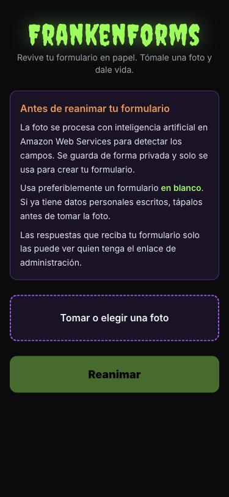
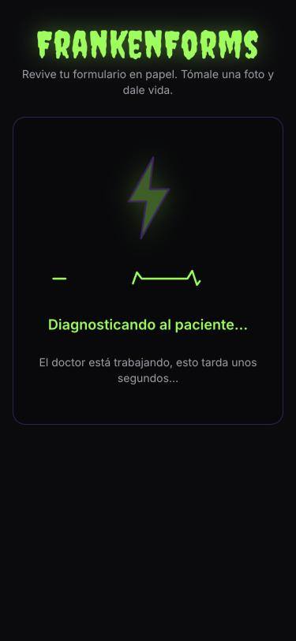
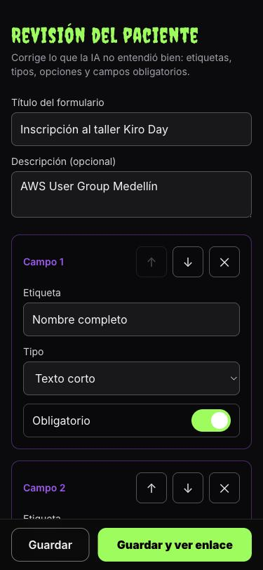
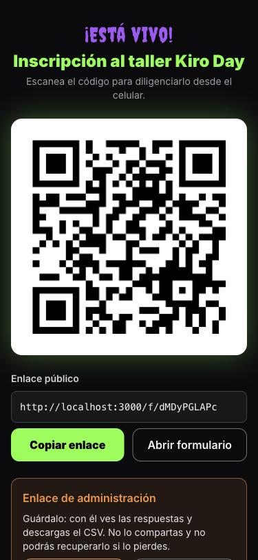
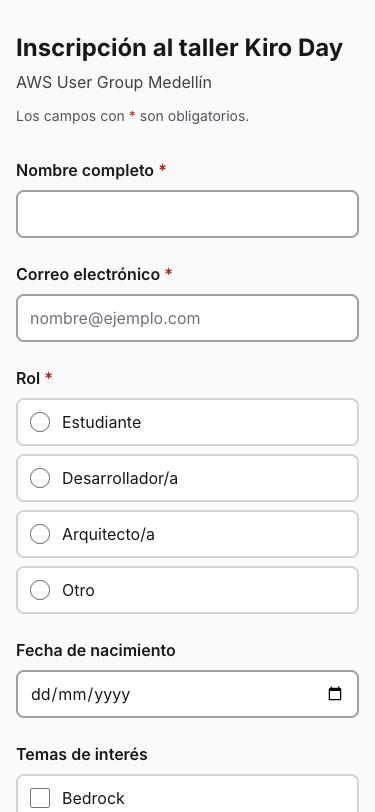
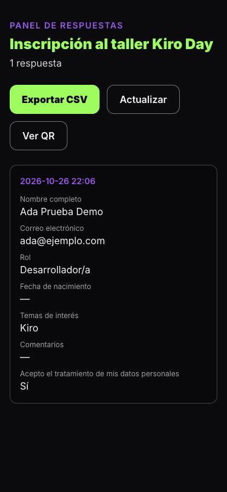
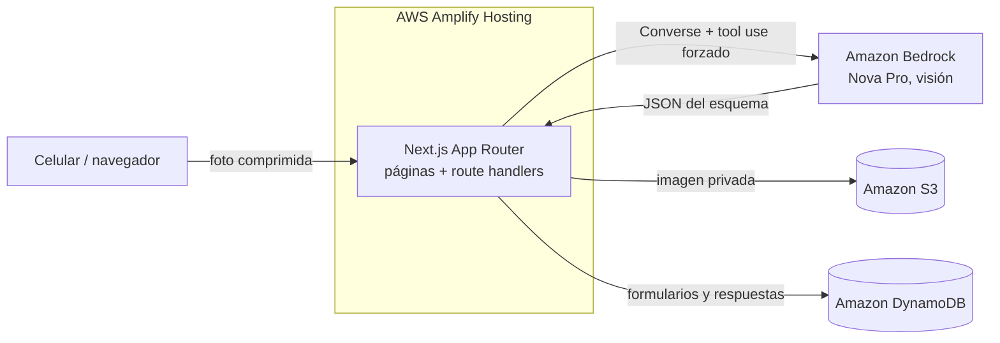

# FrankenForms 🧟⚡

**Revive el papeleo muerto.** Tómale una foto a un formulario en papel y, en menos de un minuto, tienes un formulario web funcional: con campos, validaciones, respuestas guardadas, enlace para compartir y código QR.

Proyecto individual para el **Kiro Day Medellín** del AWS User Group Medellín. #KiroDayMedellin

> Demo en vivo: `<URL de Amplify>`

## Qué hace

Muchos trámites todavía viven en hojas impresas que alguien tiene que transcribir a mano. FrankenForms hace la "autopsia" de esa hoja: un modelo de visión en Amazon Bedrock lee la foto y devuelve el esquema del formulario (etiquetas, tipos de campo, opciones y campos obligatorios) como JSON validado con Zod.

Antes de publicar, una pantalla de revisión permite corregir lo que la IA entendió mal: cambiar etiquetas, tipos y opciones, reordenar campos o marcar cuáles son obligatorios. Al publicar, el formulario "cobra vida" en `/f/{id}`, con un QR listo para escanear desde el celular.

Las respuestas se validan otra vez en el servidor, se guardan en DynamoDB y se consultan en un panel privado con exportación a CSV. El creador accede a la revisión y al panel con un enlace de administración secreto, sin cuentas ni contraseñas.

| 1. Autopsia | 2. Reanimación | 3. Revisión |
| :---: | :---: | :---: |
|  |  |  |
| **4. ¡Está vivo!** | **5. Formulario público** | **6. Respuestas** |
|  |  |  |

## Arquitectura



- **Frontend y API:** Next.js 16 (App Router), React 19, TypeScript estricto y Tailwind CSS 4.
- **IA:** Amazon Bedrock, API Converse con la herramienta `emit_form_schema` forzada. Su `inputSchema` se genera del mismo esquema Zod que valida la respuesta, y si la validación falla se reintenta una vez con el error como contexto. El modelo se configura con `BEDROCK_MODEL_ID`.
- **Datos:** una sola tabla DynamoDB (`FORM#{id}` / `META` para el formulario, `RESP#{fecha}#{uuid}` para cada respuesta) y un bucket S3 privado para las fotos.
- **Seguridad:** el SDK de AWS solo corre en el servidor, con el rol de cómputo de Amplify y permisos mínimos. Las respuestas se validan en el servidor, la clave de administración se compara en tiempo constante y el CSV se protege contra inyección de fórmulas.
- **Accesibilidad:** el formulario público usa una paleta clara de alto contraste, campos grandes y táctiles, errores anunciados a lectores de pantalla, y respeta la preferencia de movimiento reducido.

## Herramientas de Kiro

Todo lo que guía a Kiro vive en [`.kiro/`](.kiro/README.md).

| Herramienta | Dónde | Para qué se usó |
| --- | --- | --- |
| **Specs** | [`specs/frankenforms-mvp`](.kiro/specs/frankenforms-mvp) | Requisitos en formato EARS, diseño técnico y un plan de tareas ordenado. Cada tarea se desarrolló en su propia rama y se fusionó con su propio PR. |
| **Steering** | [`steering/`](.kiro/steering) | Contexto permanente: producto, stack, estructura de carpetas, convenciones y notas de AWS verificadas (Converse, tool use, variables de Amplify, rol de cómputo). |
| **Hooks** | [`hooks/`](.kiro/hooks) | Lint al guardar; revisión de `any`, tipos y secretos en `src/lib`; control de que Bedrock siga usando el esquema Zod; y dos hooks manuales, "Cerrar tarea" y "Preparar demo". |
| **MCP** | [`settings/mcp.json`](.kiro/settings/mcp.json) | Servidor de documentación de AWS para confirmar la API Converse, los permisos de IAM y la configuración SSR de Amplify antes de escribir código. |
| **Powers** | [`powers/frankenforms-bedrock`](.kiro/powers/frankenforms-bedrock/POWER.md) | Paquete de contexto para la extracción con Bedrock (prompt, tool use y validación) que se activa con palabras clave. |
| **Skills** | [`skills/git-pr-flow`](.kiro/skills/git-pr-flow/SKILL.md) | Flujo de git del evento: rama por tarea, commits convencionales en español, PR, verificación y merge con rebase para que el historial muestre el avance. |
| **Agentes** | [`agents/`](.kiro/agents) | `revisor` revisa el diff antes del merge, `aws-infra` se encarga de IAM, Amplify, DynamoDB y S3, y `qa-demo` valida el flujo completo en un viewport de celular. |

La carpeta [`.kiro/security`](.kiro/security) reúne el modelo de amenazas, la plantilla de IAM, el aviso de privacidad y el checklist previo a la demo.

## Correr en local

Requisitos: Node.js 20+, AWS CLI con un perfil que tenga acceso a los recursos de [`docs/infra.md`](docs/infra.md).

```bash
cp .env.example .env.local   # completa APP_REGION, DDB_TABLE, S3_BUCKET y BEDROCK_MODEL_ID
npm install
npm run dev                  # http://localhost:3000
```

Comprobaciones antes de cada PR:

```bash
npm run lint && npm test && npm run build
```

## Despliegue

1. Crea la tabla, el bucket privado y el rol de cómputo con la guía de [`docs/infra.md`](docs/infra.md).
2. Conecta el repositorio en AWS Amplify Hosting. El build usa [`amplify.yml`](amplify.yml).
3. Agrega las variables `APP_REGION`, `DDB_TABLE`, `S3_BUCKET` y `BEDROCK_MODEL_ID`, asigna el rol de cómputo y vuelve a desplegar.
4. Publica el formulario de respaldo para la demo con [`scripts/seed-demo.ts`](scripts/README.md).

## Alcance

El MVP incluye formularios de una página con campos de texto, área de texto, número, fecha, correo, selección y casillas, además de validaciones de obligatorio, correo, longitud, rango y patrón. Fuera del alcance quedan varias páginas, tablas, firmas y autenticación de usuarios.

## Créditos

Hecho por Santiago Romero para el **Kiro Day Medellín**. Gracias al **AWS User Group Medellín** (@awsugmed) por el espacio.

#KiroDayMedellin #Kiro #AWS #AmazonBedrock
