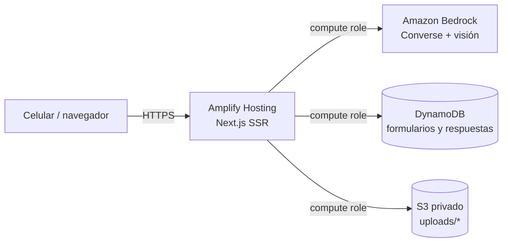

# Infraestructura en AWS

Guía para crear desde cero la infraestructura de FrankenForms con AWS CLI v2.
Todos los valores entre `<...>` son placeholders: **nunca** subas al repo IDs de cuenta, ARNs reales ni claves.



| Recurso | Uso | Variable de entorno |
| --- | --- | --- |
| Tabla DynamoDB (on-demand) | Formularios (`FORM#{id}` / `META`) y respuestas (`RESP#…`) | `DDB_TABLE` |
| Bucket S3 privado | Fotos originales en `uploads/{id}.jpg` | `S3_BUCKET` |
| Inference profile de Bedrock | Extraer el esquema desde la foto | `BEDROCK_MODEL_ID` |
| Rol de cómputo de Amplify | Credenciales temporales del servidor | — |
| Región | Todos los recursos | `APP_REGION` |

> Amplify no permite variables que empiecen por `AWS_`; por eso se usa `APP_REGION`.

## 0. Variables de la sesión

Define estos valores una sola vez en tu terminal. En zsh usa siempre `${VAR}` con llaves:
`$VAR:algo` se interpreta como un modificador y rompe los ARNs.

```bash
export REGION="<REGION>"                         # ej. us-east-1
export ACCOUNT_ID="$(aws sts get-caller-identity --query Account --output text)"
export TABLE_NAME="<TABLE_NAME>"                 # ej. frankenforms
export BUCKET_NAME="<BUCKET_NAME>"               # único a nivel global, ej. frankenforms-uploads-<sufijo>
export ROLE_NAME="<ROLE_NAME>"                   # ej. frankenforms-amplify-compute
export INFERENCE_PROFILE_ID="<INFERENCE_PROFILE_ID>"   # ej. us.amazon.nova-pro-v1:0
export FOUNDATION_MODEL_ID="<FOUNDATION_MODEL_ID>"     # ej. amazon.nova-pro-v1:0
```

## 1. Tabla DynamoDB

Tabla única con claves `pk` y `sk` de tipo texto, en modo on-demand (solo se paga por uso).

```bash
aws dynamodb create-table \
  --region "${REGION}" \
  --table-name "${TABLE_NAME}" \
  --attribute-definitions AttributeName=pk,AttributeType=S AttributeName=sk,AttributeType=S \
  --key-schema AttributeName=pk,KeyType=HASH AttributeName=sk,KeyType=RANGE \
  --billing-mode PAY_PER_REQUEST

aws dynamodb wait table-exists --region "${REGION}" --table-name "${TABLE_NAME}"
```

## 2. Bucket S3 privado

Las fotos pueden contener datos personales: el bucket nunca es público.

```bash
# En us-east-1 no se pasa --create-bucket-configuration; en otras regiones sí.
aws s3api create-bucket --region "${REGION}" --bucket "${BUCKET_NAME}"
# Otras regiones:
# aws s3api create-bucket --region "${REGION}" --bucket "${BUCKET_NAME}" \
#   --create-bucket-configuration LocationConstraint="${REGION}"

# Bloquear todo acceso público.
aws s3api put-public-access-block --bucket "${BUCKET_NAME}" \
  --public-access-block-configuration \
  BlockPublicAcls=true,IgnorePublicAcls=true,BlockPublicPolicy=true,RestrictPublicBuckets=true

# Sin ACLs: el dueño del bucket es dueño de todos los objetos.
aws s3api put-bucket-ownership-controls --bucket "${BUCKET_NAME}" \
  --ownership-controls 'Rules=[{ObjectOwnership=BucketOwnerEnforced}]'

# Cifrado en reposo (SSE-S3).
aws s3api put-bucket-encryption --bucket "${BUCKET_NAME}" \
  --server-side-encryption-configuration \
  '{"Rules":[{"ApplyServerSideEncryptionByDefault":{"SSEAlgorithm":"AES256"}}]}'
```

Comprobación: `aws s3api get-public-access-block --bucket "${BUCKET_NAME}"` debe mostrar los cuatro valores en `true`.

## 3. Acceso al modelo en Bedrock

- **Amazon Nova** (recomendado, es el que usa la demo): está disponible sin formularios adicionales.
- **Anthropic Claude**: antes de invocarlo hay que enviar el formulario de caso de uso de Anthropic en la consola de Bedrock (*Model access*). Sin eso, Bedrock responde `403 AccessDeniedException`.

Los IDs que empiezan por `us.` son *inference profiles* entre regiones: Bedrock puede atender la llamada en `us-east-1`, `us-east-2` o `us-west-2`. Por eso la política del paso 4 permite el modelo base en esas tres regiones.

Prueba rápida de acceso:

```bash
aws bedrock-runtime converse --region "${REGION}" \
  --model-id "${INFERENCE_PROFILE_ID}" \
  --messages '[{"role":"user","content":[{"text":"Responde solo: ok"}]}]' \
  --query 'output.message.content[0].text' --output text
```

## 4. Rol de cómputo de Amplify (IAM mínimo)

Amplify asume este rol en el servidor (route handlers de Next.js). No se usan claves de acceso.

### 4a. Política de confianza

```bash
cat > /tmp/ff-trust.json <<JSON
{
  "Version": "2012-10-17",
  "Statement": [
    {
      "Effect": "Allow",
      "Principal": { "Service": "amplify.amazonaws.com" },
      "Action": "sts:AssumeRole"
    }
  ]
}
JSON

aws iam create-role --role-name "${ROLE_NAME}" \
  --assume-role-policy-document file:///tmp/ff-trust.json
```

### 4b. Política de permisos

Solo lo que usa el código: `GetItem`, `PutItem`, `UpdateItem` y `Query` en la tabla; `PutObject` y `GetObject` en `uploads/*`; e `InvokeModel` en el modelo elegido. La plantilla equivalente está en [`.kiro/security/iam-policy.template.json`](../.kiro/security/iam-policy.template.json).

```bash
cat > /tmp/ff-policy.json <<JSON
{
  "Version": "2012-10-17",
  "Statement": [
    {
      "Sid": "BedrockInvoke",
      "Effect": "Allow",
      "Action": "bedrock:InvokeModel",
      "Resource": [
        "arn:aws:bedrock:${REGION}:${ACCOUNT_ID}:inference-profile/${INFERENCE_PROFILE_ID}",
        "arn:aws:bedrock:us-east-1::foundation-model/${FOUNDATION_MODEL_ID}",
        "arn:aws:bedrock:us-east-2::foundation-model/${FOUNDATION_MODEL_ID}",
        "arn:aws:bedrock:us-west-2::foundation-model/${FOUNDATION_MODEL_ID}"
      ]
    },
    {
      "Sid": "DynamoDBTable",
      "Effect": "Allow",
      "Action": ["dynamodb:GetItem", "dynamodb:PutItem", "dynamodb:UpdateItem", "dynamodb:Query"],
      "Resource": "arn:aws:dynamodb:${REGION}:${ACCOUNT_ID}:table/${TABLE_NAME}"
    },
    {
      "Sid": "S3Uploads",
      "Effect": "Allow",
      "Action": ["s3:PutObject", "s3:GetObject"],
      "Resource": "arn:aws:s3:::${BUCKET_NAME}/uploads/*"
    }
  ]
}
JSON

# Validar la sintaxis antes de aplicarla.
python3 -m json.tool /tmp/ff-policy.json > /dev/null && echo "JSON válido"

aws iam put-role-policy --role-name "${ROLE_NAME}" \
  --policy-name frankenforms-min \
  --policy-document file:///tmp/ff-policy.json

rm /tmp/ff-trust.json /tmp/ff-policy.json
```

Si más adelante pruebas otro modelo, agrega su inference profile y su modelo base a `Resource`; no uses `*`.

## 5. Amplify Hosting

Estos pasos se hacen en la consola de AWS:

1. **Amplify → Create new app → GitHub**: autoriza el repositorio y elige la rama `main`. Amplify detecta Next.js y usa el [`amplify.yml`](../amplify.yml) del repo.
2. **Environment variables** (*Hosting → Environment variables*):

   | Variable | Valor |
   | --- | --- |
   | `APP_REGION` | `<REGION>` |
   | `DDB_TABLE` | `<TABLE_NAME>` |
   | `S3_BUCKET` | `<BUCKET_NAME>` |
   | `BEDROCK_MODEL_ID` | `<INFERENCE_PROFILE_ID>` |

   El `amplify.yml` copia estas cuatro variables a `.env.production` durante el build, porque el runtime SSR no las recibe de forma automática.
3. **IAM roles** (*App settings → IAM roles → Compute role*): elige `<ROLE_NAME>` y guarda.
4. Lanza un nuevo despliegue (*Redeploy this version*) para que el cambio de rol y variables se aplique.

## 6. Verificación después del despliegue

- Abre la URL de Amplify en el celular, sube una foto y confirma que llegas a la pantalla de revisión.
- Si falla, revisa *Hosting → Monitoring → Hosting compute logs* (CloudWatch):

| Síntoma | Causa probable |
| --- | --- |
| `AccessDeniedException` de Bedrock | Falta el modelo en la política o no se aceptó el acceso al modelo |
| `ResourceNotFoundException` de DynamoDB | `DDB_TABLE` o `APP_REGION` mal escritas |
| `Could not load credentials` | El compute role no está asignado o no se redesplegó |
| Variables vacías en el servidor | Faltan en la consola o no se redesplegó después de agregarlas |

## 7. Costos y limpieza

Todo es pago por uso: DynamoDB on-demand, S3 por GB y Bedrock por token. Crea un presupuesto en **Billing → Budgets** con alerta por correo antes de la demo.

Para borrar todo después del evento (irreversible):

```bash
aws s3 rm "s3://${BUCKET_NAME}" --recursive
aws s3api delete-bucket --bucket "${BUCKET_NAME}"
aws dynamodb delete-table --region "${REGION}" --table-name "${TABLE_NAME}"
aws iam delete-role-policy --role-name "${ROLE_NAME}" --policy-name frankenforms-min
aws iam delete-role --role-name "${ROLE_NAME}"
# La app de Amplify se borra desde la consola: App settings → General → Delete app.
```
